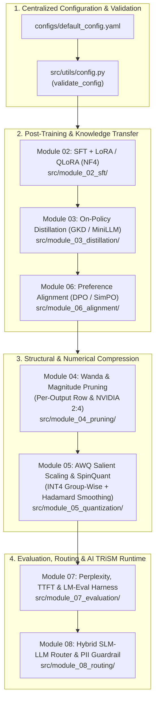

# Architecture & Mathematical Specification (`slm-masterclass`)

> **Principal Architect:** [Vinicius Caridá (`vfcarida`)](https://github.com/vfcarida)  
> **Package Version:** `1.1.0` | **License:** MIT

---

## 1. Architectural Vision & Design Principles

`slm-masterclass` is engineered around a **Dual-Layer Glass-Box Architecture**:
1. **Pure-PyTorch Mathematical Core:** Every compression, distillation, pruning, quantization, alignment, evaluation, and routing module exposes deterministic, self-contained PyTorch mathematical functions that can be inspected, composed, and unit-tested on CPU in milliseconds without external GPU clusters.
2. **Production Ecosystem Orchestration:** Each module pairs its mathematical core with industry-standard Hugging Face (`transformers`, `peft`, `trl`, `datasets`), `bitsandbytes`, `AutoAWQ`, `vLLM`, and `EleutherAI lm-evaluation-harness` integration pipelines driven by a single validated YAML manifest ([`configs/default_config.yaml`](configs/default_config.yaml)).



---

## 2. Repository Topology

```text
Small-Language-Models-SLMs-/
├── configs/
│   └── default_config.yaml              # Validated single source of truth for all hyperparameters
├── docs/                                # Progressive theoretical & mathematical documentation
│   ├── 00_Fundamentals.md               # BPE tokenization, Scaled Dot-Product Attention & GQA math
│   ├── 01_Inference.md                  # Decoding strategies (Greedy, Top-K, Top-P) & TTFT/Throughput
│   ├── 02_Supervised_Finetuning.md      # LoRA low-rank decomposition & 4-bit NormalFloat (QLoRA)
│   ├── 03_Distillation.md               # Forward KL, Reverse KL (MiniLLM), and Generalized JSD (GKD)
│   ├── 04_Pruning.md                    # Magnitude & Wanda pruning (per-output row & NVIDIA 2:4)
│   ├── 05_Quantization.md               # AWQ salient scaling, SpinQuant Hadamard & NF4 Double Quant
│   ├── 06_Alignment.md                  # Bradley-Terry DPO & Reference-Free SimPO preference losses
│   ├── 07_Evaluation.md                 # Sliding-window perplexity & EleutherAI LM-Eval benchmarks
│   └── 08_Hybrid_Routing_and_Guardrails.md # Calibrated SLM-LLM routing, AI TRiSM PII guardrails & ROI
├── eval/
│   └── benchmarks/
│       └── latency_tracker.py           # Cross-architecture TTFT, VRAM & MMLU/GSM8K profiler
├── pipeline/
│   ├── run_full_pipeline.py             # End-to-end 6-stage training, merging & evaluation pipeline
│   └── generate_report.py               # Automated Markdown executive report compiler
├── src/
│   ├── utils/
│   │   ├── config.py                    # Schema validation & project root discovery
│   │   ├── data_utils.py                # Alpaca, ChatTemplate & preference dataset builders
│   │   └── metrics.py                   # Perplexity, CUDA OOM recovery, sparsity & latency timers
│   ├── module_00_fundamentals/          # attention_visualizer.py, tokenizer_explorer.py
│   ├── module_01_inference/             # basic_inference.py
│   ├── module_02_sft/                   # sft_lora.py, sft_qlora.py
│   ├── module_03_distillation/          # gkd_pipeline.py
│   ├── module_04_pruning/               # magnitude_pruning.py, wanda_pruning.py
│   ├── module_05_quantization/          # awq_quantization.py, bitsandbytes_quant.py
│   ├── module_06_alignment/             # dpo_trainer.py
│   ├── module_07_evaluation/            # benchmark_runner.py, perplexity_eval.py, results_visualizer.py
│   └── module_08_routing/               # hybrid_router.py
└── tests/                               # 100% CPU-verifiable unit & mathematical property test suite
```

---

## 3. Core Mathematical Invariants

### 3.1 Knowledge Distillation Divergences (`src/module_03_distillation/gkd_pipeline.py`)
For student distribution $p_S = \text{softmax}(z_S / T)$, teacher distribution $p_T = \text{softmax}(z_T / T)$, and mixture $M = \beta p_T + (1 - \beta) p_S$:
- **Non-Negativity & Identity:** $\mathcal{L}(z_S, z_T) \ge 0$ for all $(z_S, z_T)$, with $\mathcal{L}(z, z) = 0$.
- **Symmetric JSD Boundary:** At $\beta = 0.5$, $\mathcal{L}_{\text{JSD}}^{(0.5)}(z_S, z_T) = \mathcal{L}_{\text{JSD}}^{(0.5)}(z_T, z_S)$.

### 3.2 Per-Output Wanda & 2:4 Semi-Structured Pruning (`src/module_04_pruning/wanda_pruning.py`)
For linear weight matrix $W \in \mathbb{R}^{d_{\text{out}} \times d_{\text{in}}}$ and input channel $L_2$ norms $\|X_j\|_2$:
- **Importance Metric:** $S_{ij} = |W_{ij}| \cdot \|X_j\|_2$.
- **Row-Wise Comparison Group Invariant (`unstructured`):** Every output row $i \in \{1, \dots, d_{\text{out}}\}$ has exactly $\lfloor s \cdot d_{\text{in}} \rfloor$ zeroed weights.
- **2:4 Semi-Structured Invariant (`2:4`):** Every contiguous 4-element block $W_{i, 4k : 4k+4}$ contains at least 2 exact zeros.

### 3.3 Activation-Aware Salient Scaling & Rotation Invariance (`src/module_05_quantization/awq_quantization.py`)
- **AWQ Monotonicity over Naive RTN:** Because $\alpha = 0$ corresponds to standard Round-To-Nearest (RTN) quantization in the grid search over $\alpha \in [0, 1]$, the optimal AWQ scale $s(\alpha^*) = s_X^{\alpha^*}$ guarantees $\text{MSE}_{\text{AWQ}} \le \text{MSE}_{\text{RTN}}$.
- **Hadamard Rotation Equivalence:** For normalized Hadamard matrix $H$ ($H^\top H = I$), $(X H)(W H)^\top = X W^\top$ holds up to floating-point precision while reducing $\max |X|$.

### 3.4 Preference Optimization & Hybrid Routing (`module_06_alignment` & `module_08_routing`)
- **Reference-Free SimPO Margin:** Eliminates reference model memory overhead via length-normalized reward $r_{\text{SimPO}}(x, y) = \frac{\beta}{|y|} \log \pi_\theta(y \mid x)$ and margin $\gamma \ge 0$.
- **AI TRiSM Data-Sovereignty Invariant:** When `enforce_local_on_pii=True`, any query matching `PIIGuardrail` is strictly prevented from routing to `RouteTarget.CLOUD_LLM`.
