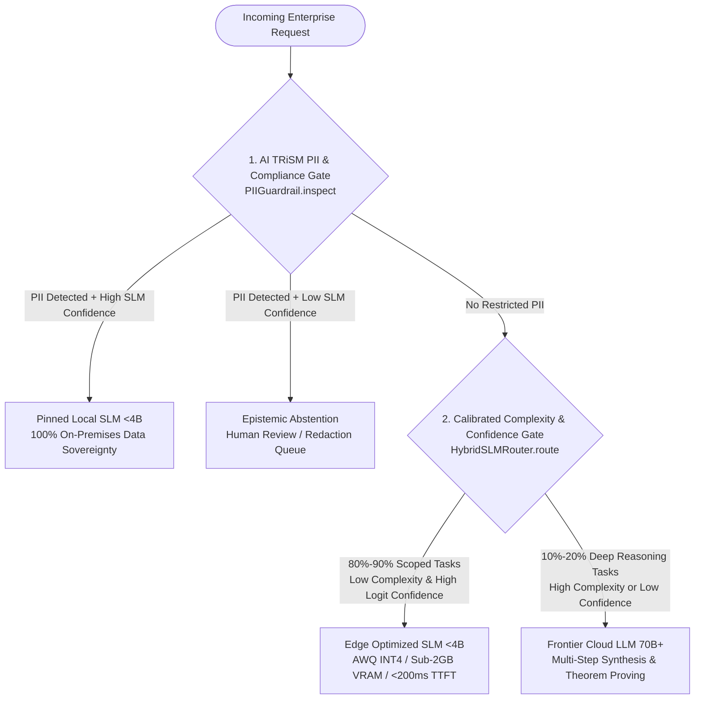
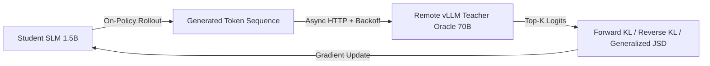

# 🚀 Small Language Models (SLMs) Masterclass

<div align="center">

[](https://www.python.org/)
[](https://pytorch.org/)
[](https://developer.nvidia.com/cuda-toolkit)
[](https://github.com/vfcarida/Small-Language-Models-SLMs-/actions/workflows/python-tests.yml)
[](https://github.com/huggingface/trl)
[](LICENSE)

**The production-grade reference playbook and glass-box PyTorch toolkit for training, distilling, pruning, quantizing, aligning, evaluating, and routing Small Language Models (<4B parameters) in constrained enterprise and edge environments.**

[Architecture Specification](ARCHITECTURE.md) • [Product Roadmap & Governance](ROADMAP.md) • [Contributing Guide](CONTRIBUTING.md) • [Citation (`CITATION.cff`)](CITATION.cff)

</div>

---

## 📑 Table of Contents

- [Executive Overview & Core Thesis](#-executive-overview--core-thesis)
- [The "Small-First" Enterprise Routing Architecture](#️-the-small-first-enterprise-routing-architecture)
- [Progressive Curriculum & Architecture Modules](#-progressive-curriculum--architecture-modules)
- [Scientific Foundations & Mathematical Formulations](#-scientific-foundations--mathematical-formulations)
- [Quickstart & CLI Entry Points](#️-quickstart--cli-entry-points)
- [Global Benchmarks & Enterprise Feasibility Matrix](#-global-benchmarks--enterprise-feasibility-matrix)
- [Testing, Reproducibility & Maturity Governance](#-testing-reproducibility--maturity-governance)
- [Key Academic & Industry References](#-key-academic--industry-references)

---

## 💡 Executive Overview & Core Thesis

Routing every enterprise workload to a massive, general-purpose frontier Large Language Model (e.g., 70B–1T+ parameters) creates an unsustainable operational triad:
1. **The Agentic Cost Multiplier:** Modern agentic workflows trigger dozens of model invocations per user request (intent classification, entity extraction, query rewriting, tool routing, validation). Executing every subtask on a frontier LLM inflates token costs by **$10\times$ to $30\times$** ([Belcák et al., NVIDIA Research 2025](https://arxiv.org/abs/2506.02153); [McKinsey State of AI](https://www.mckinsey.com/)).
2. **Real-Time Latency SLAs:** High Time-To-First-Token (TTFT $>500\text{ ms}$) and network round-trips degrade interactive user experiences and inline operational pipelines.
3. **Data Sovereignty & Regulatory Compliance (GDPR / LGPD / HIPAA / Gartner AI TRiSM):** Transmitting sensitive financial records, healthcare logs, or personally identifiable information (PII) to external multi-tenant cloud APIs introduces severe compliance risk.

**Small Language Models (SLMs)**—compact models under **4B parameters** such as **Qwen2.5-1.5B**, **Llama-3.2-1B**, and **Phi-3.5-mini**—resolve this triad. When adapted via **LoRA/QLoRA**, distilled via **On-Policy Generalized Knowledge Distillation (GKD / MiniLLM)**, compressed via **Wanda Pruning** and **AWQ INT4 Quantization**, aligned via **DPO / Reference-Free SimPO**, and orchestrated behind a **Calibrated Hybrid Router**, SLMs deliver frontier-grade domain accuracy within a **sub-2 GB VRAM envelope** at **$<200\text{ ms}$ TTFT**.

---

## 🏛️ The "Small-First" Enterprise Routing Architecture

Operationalizing **RouteLLM** ([Ong et al., ICLR 2025](https://arxiv.org/abs/2406.18665)), **Minions** ([Narayan et al., Stanford 2025](https://arxiv.org/abs/2502.15964)), and **Gartner AI TRiSM** runtime controls, [`src/module_08_routing/hybrid_router.py`](src/module_08_routing/hybrid_router.py) implements a calibrated three-gate routing engine:



---

## 📚 Progressive Curriculum & Architecture Modules

Every module pairs a **self-contained, CPU-testable PyTorch mathematical implementation** with a **production Hugging Face / TRL / AutoAWQ / vLLM pipeline** and a comprehensive theoretical guide in [`docs/`](docs/):

| Module | Documentation Guide | Source Implementation | Core Capabilities & Mathematical Scope | Maturity |
| :---: | :--- | :--- | :--- | :---: |
| **00** | [`docs/00_Fundamentals.md`](docs/00_Fundamentals.md) | [`src/module_00_fundamentals/`](src/module_00_fundamentals/) | Subword BPE compression profiling, Scaled Dot-Product Attention math, attention heatmaps, and MHA vs. GQA KV-cache memory calculator. | `Stable` |
| **01** | [`docs/01_Inference.md`](docs/01_Inference.md) | [`src/module_01_inference/`](src/module_01_inference/) | Autoregressive decoding (`greedy`, `sample`, `top_k`, `top_p`), `torch.compile`, SDPA/FlashAttention-2 detection, and CUDA-synchronized TTFT/throughput timers. | `Stable` |
| **02** | [`docs/02_Supervised_Finetuning.md`](docs/02_Supervised_Finetuning.md) | [`src/module_02_sft/`](src/module_02_sft/) | Supervised Fine-Tuning with all-linear **LoRA** and 4-bit NormalFloat **QLoRA (`NF4`)**, analytical adapter merging, and dynamic `GPUOOMHandler` recovery. | `Stable` |
| **03** | [`docs/03_Distillation.md`](docs/03_Distillation.md) | [`src/module_03_distillation/`](src/module_03_distillation/) | Temperature-scaled **Forward KL**, Mode-Seeking **Reverse KL (`MiniLLM`)**, **Generalized Jensen-Shannon Divergence (`GKD`)**, and decoupled `VLLMTeacherOracle` client. | `Stable` |
| **04** | [`docs/04_Pruning.md`](docs/04_Pruning.md) | [`src/module_04_pruning/`](src/module_04_pruning/) | One-shot **Magnitude** and **Wanda** pruning ($S_{ij} = \|W_{ij}\| \cdot \|X_j\|_2$) with **per-output row (`dim=1`)** comparison groups, **NVIDIA `2:4` semi-structured sparsity**, and Zipf lexical entropy calibration. | `Stable` |
| **05** | [`docs/05_Quantization.md`](docs/05_Quantization.md) | [`src/module_05_quantization/`](src/module_05_quantization/) | Pure-PyTorch **AWQ** salient-channel grid search ($s = s_X^\alpha$), **SpinQuant** Hadamard & **Cayley Stiefel (`INT3`/`INT2`)** rotation (`cayley_kv_quant.py`), **Asymmetric `INT4` KV-Cache**, and `NF4` Double-Quant calculator. | `Stable` |
| **06** | [`docs/06_Alignment.md`](docs/06_Alignment.md) | [`src/module_06_alignment/`](src/module_06_alignment/) | Closed-form Bradley-Terry **DPO** loss (`compute_dpo_loss`) and **Reference-Free SimPO** loss (`compute_simpo_loss`) with length normalization and target reward margin $\gamma$. | `Stable` |
| **07** | [`docs/07_Evaluation.md`](docs/07_Evaluation.md) | [`src/module_07_evaluation/`](src/module_07_evaluation/) & [`eval/benchmarks/`](eval/benchmarks/) | Overlapping sliding-window perplexity, EleutherAI `lm-evaluation-harness` runner (`MMLU`, `GSM8K`), **Cross-Architecture Empirical Pareto Suite** (`pareto_suite.py`), and radar charts. | `Stable` |
| **08** | [`docs/08_Hybrid_Routing_and_Guardrails.md`](docs/08_Hybrid_Routing_and_Guardrails.md) | [`src/module_08_routing/`](src/module_08_routing/) | **Hybrid SLM-LLM Router**, **RouteLLM Bradley-Terry & Matrix Factorization Calibration** (`router_calibration.py`), `PIIGuardrail` (AI TRiSM), and TCO/ROI calculator. | `Stable` |
| **09** | [`docs/09_Edge_Export_and_OpenAI_Serving.md`](docs/09_Edge_Export_and_OpenAI_Serving.md) | [`src/module_09_serving/`](src/module_09_serving/) | **Edge Runtime Exporter** (`GGUF` / `llama.cpp` / `Ollama`, `vLLM` PagedAttention validator, TorchScript/`ONNX` parity exporter) and **OpenAI `/v1/chat/completions` + MCP JSON-RPC 2.0 Gateway**. | `Stable` |
| **10** | [`docs/10_Speculative_Decoding.md`](docs/10_Speculative_Decoding.md) | [`src/module_10_speculative/`](src/module_10_speculative/) | **Lossless Speculative Decoding** (`speculative_decoding_step`), residual distribution normalization, marginal identity verifier, speedup law, and **Medusa Multi-Horizon Draft Heads**. | `Stable` |
| **11** | [`docs/11_RLVR_and_GRPO.md`](docs/11_RLVR_and_GRPO.md) | [`src/module_11_rlvr_grpo/`](src/module_11_rlvr_grpo/) | **Reinforcement Learning with Verifiable Rewards (`RLVR`) & Critic-Free `GRPO`** (`compute_grpo_loss`, Schulman KL, and deterministic `<think>/<answer>`, math & JSON verifiers). | `Stable` |
| **12** | [`docs/12_Hybrid_Mamba_Transformer_SLMs.md`](docs/12_Hybrid_Mamba_Transformer_SLMs.md) | [`src/module_12_hybrid_ssm/`](src/module_12_hybrid_ssm/) | **State-Space & Hybrid Mamba-Transformer SLMs** (`SelectiveSSMBlock` with $O(1)$-memory `step_recurrent`, `HybridMambaAttentionBlock`, and 32k context memory scaling profiler). | `Stable` |
| **13** | [`docs/13_Multi_Agent_SLM_Swarms.md`](docs/13_Multi_Agent_SLM_Swarms.md) | [`src/module_13_agentic_swarms/`](src/module_13_agentic_swarms/) | **Multi-Agent Collaborative SLM Swarms & Debate Verification** (`MultiLoRASwarmBackbone`, `confidence_weighted_vote`, and 2-round Generator-Critic-Verifier debate with `PIIGuardrail`). | `Stable` |
| **14** | [`docs/14_Federated_and_DP_LoRA.md`](docs/14_Federated_and_DP_LoRA.md) | [`src/module_14_federated_dp_lora/`](src/module_14_federated_dp_lora/) | **Federated & Differential-Privacy LoRA Aggregation** (`DP-SGD` per-sample $L_2$ clipping + calibrated Gaussian noise, `FFA-LoRA`, and `SVD-Exact` cross-term-free aggregation). | `Stable` |
| **15** | [`docs/15_BitNet_Ternary_SLMs.md`](docs/15_BitNet_Ternary_SLMs.md) | [`src/module_15_bitnet_ternary/`](src/module_15_bitnet_ternary/) | **Ternary `1.58-Bit` Native SLMs (`BitNet b1.58`)** (`quantize_weights_absmean_ternary` $\{-1,0,+1\}$, per-token `INT8` `BitLinear` with STE, and multiplier-free `forward_add_only` kernel). | `Stable` |
| **16** | [`docs/16_Latent_Space_Reasoning.md`](docs/16_Latent_Space_Reasoning.md) | [`src/module_16_latent_reasoning/`](src/module_16_latent_reasoning/) | **Latent-Space Continuous Reasoning (`Coconut` & Recurrent Depth)** (`LatentThoughtReasoner`, symmetric-KL `AdaptivePonderingGate`, and CoT vs. Coconut KV/latency profiler). | `Stable` |
| **17** | [`docs/17_Layer_Adaptive_Mixed_Precision.md`](docs/17_Layer_Adaptive_Mixed_Precision.md) | [`src/module_17_mixed_precision/`](src/module_17_mixed_precision/) | **Layer-Adaptive Mixed-Precision (`LAMP`) & Hessian Bit Allocator** (`compute_layer_hessian_sensitivity`, optimal `{2,3,4,8}`-bit solver `allocate_mixed_precision_bits`, and `apply_lamp_mixed_precision`). | `Stable` |
| **18** | [`docs/18_Grammar_Constrained_Decoding.md`](docs/18_Grammar_Constrained_Decoding.md) | [`src/module_18_constrained_decoding/`](src/module_18_constrained_decoding/) | **Grammar-Constrained & FSM Structured Decoding (`Outlines` / `XGrammar`)** (`FiniteStateGrammarIndex`, zero-overhead `apply_fsm_logit_mask`, and 100%-valid `JSONSchemaFSMDecoder`). | `Stable` |
| **19** | [`docs/19_Cross_Tokenizer_Distillation.md`](docs/19_Cross_Tokenizer_Distillation.md) | [`src/module_19_cross_tokenizer_kd/`](src/module_19_cross_tokenizer_kd/) | **Cross-Tokenizer Knowledge Distillation (`ULD` & `MinED`)** (1D Wasserstein Optimal Transport `compute_uld_wasserstein_loss`, Levenshtein projection `align_cross_tokenizer_vocab`, and `CrossTokenizerDistiller`). | `Stable` |
| **20** | [`docs/20_Mixture_of_Depths_and_Sparse_Routing.md`](docs/20_Mixture_of_Depths_and_Sparse_Routing.md) | [`src/module_20_mixture_of_depths/`](src/module_20_mixture_of_depths/) | **Mixture-of-Depths (`MoD`) & Dynamic Token Routing** (`MixtureOfDepthsBlock` capacity-bounded Top-$K$ gather/scatter, causal BCE predictor `compute_mod_auxiliary_loss`, and FLOPs profiler). | `Stable` |

---

## 🔬 Scientific Foundations & Mathematical Formulations

### 1. On-Policy Knowledge Distillation: Forward KL, Reverse KL (`MiniLLM`) & Generalized JSD (`GKD`)
To eliminate autoregressive exposure bias and prevent low-capacity students from overestimating low-density teacher voids, [`src/module_03_distillation/gkd_pipeline.py`](src/module_03_distillation/gkd_pipeline.py) implements (`compute_distillation_loss`):

$$\mathcal{L}_{\text{RKL}}(p_S \parallel p_T) = T^2 \sum_{v \in V} p_S(v) \log \frac{p_S(v)}{p_T(v)}, \quad \mathcal{L}_{\text{JSD}}^{(\beta)}(p_T \parallel p_S) = T^2 \left[ \beta D_{\text{KL}}(p_T \parallel M) + (1-\beta) D_{\text{KL}}(p_S \parallel M) \right]$$

where $M = \beta p_T + (1-\beta) p_S$ for $\beta \in [0, 1]$.



### 2. One-Shot Weight-Activation Pruning (`Wanda` Unstructured & NVIDIA `2:4`)
In [`src/module_04_pruning/wanda_pruning.py`](src/module_04_pruning/wanda_pruning.py), weight importance is scored by multiplying weight magnitude by the $L_2$ norm of calibration input activations across $N \cdot L$ tokens:

$$S_{ij} = |W_{ij}| \cdot \|X_j\|_2, \quad \|X_j\|_2 = \sqrt{\sum_{t=1}^{N \cdot L} X_{t, j}^2}$$

Weights are pruned **per-output row $i$ (`dim=1`)**—or within contiguous 4-element blocks for **NVIDIA `2:4` Sparse Tensor Core** acceleration—without requiring Hessian inversion or gradient updates.

### 3. Activation-Aware Weight Quantization (`AWQ`) & Orthogonal Rotation Smoothing (`SpinQuant`)
In [`src/module_05_quantization/awq_quantization.py`](src/module_05_quantization/awq_quantization.py), salient weight channels are protected prior to group-wise INT4 quantization $Q(\cdot)$ via optimal per-channel activation scaling $s(\alpha) = s_X^\alpha$, and extreme activation outliers are dispersed via orthonormal Hadamard rotations $H^\top H = I$:

$$\alpha^* = \arg\min_{\alpha \in [0, 1]} \left\| Q\left(W \cdot \text{diag}(s_X^\alpha)\right) \text{diag}(s_X^{-\alpha}) X - W X \right\|_F^2, \quad (X H)(W H)^\top = X W^\top$$

### 4. Preference Alignment: `DPO` vs. Reference-Free `SimPO`
In [`src/module_06_alignment/dpo_trainer.py`](src/module_06_alignment/dpo_trainer.py), both reference-anchored **DPO** (`compute_dpo_loss`) and memory-optimal **Reference-Free SimPO** (`compute_simpo_loss`) are provided:

$$\mathcal{L}_{\text{SimPO}}(\pi_\theta) = -\mathbb{E}_{(x, y_w, y_l)} \left[ \log \sigma \left( \frac{\beta}{|y_w|} \log \pi_\theta(y_w \mid x) - \frac{\beta}{|y_l|} \log \pi_\theta(y_l \mid x) - \gamma \right) \right]$$

---

## 🛠️ Quickstart & CLI Entry Points

### 1. Installation

```bash
git clone https://github.com/vfcarida/Small-Language-Models-SLMs-.git
cd Small-Language-Models-SLMs-

# Editable installation with developer & testing extras (runs on CPU or GPU)
pip install -e ".[dev]"

# Full GPU installation (includes quantization and evaluation extras)
pip install -r requirements.txt
pip install -e .
```

### 2. Run the Hybrid SLM-LLM Router, RouteLLM Calibration & Pareto Suite (CPU/GPU)

```bash
# Run Hybrid SLM-LLM Routing & AI TRiSM Telemetry Demo:
python src/module_08_routing/hybrid_router.py

# Train & calibrate the Bradley-Terry / Matrix Factorization Preference Router (RouteLLM):
python src/module_08_routing/router_calibration.py

# Run the Cross-Architecture Empirical Pareto Suite & Live PyTorch Compression Ablation:
python eval/benchmarks/pareto_suite.py

# Export GGUF/vLLM/TorchScript Edge Manifests & Smoke-Test the OpenAI + MCP Gateway:
python src/module_09_serving/edge_exporter.py
python src/module_09_serving/openai_server.py --smoke-test

# Run Cayley Stiefel Sub-4-Bit Rotation, Speculative Decoding & DeepSeek-R1 Style GRPO:
python src/module_05_quantization/cayley_kv_quant.py
python src/module_10_speculative/speculative_decoding.py
python src/module_11_rlvr_grpo/grpo_trainer.py

# Run Hybrid Mamba-Transformer SSM, Multi-Agent SLM Swarms & Federated DP-LoRA:
python src/module_12_hybrid_ssm/hybrid_ssm_block.py
python src/module_13_agentic_swarms/slm_swarm.py
python src/module_14_federated_dp_lora/dp_federated_lora.py

# Run BitNet b1.58 Ternary SLMs, Coconut Latent Reasoning & LAMP Mixed-Precision:
python src/module_15_bitnet_ternary/bitnet_linear.py
python src/module_16_latent_reasoning/coconut_reasoning.py
python src/module_17_mixed_precision/lamp_allocator.py

# Run Grammar-Constrained FSM Decoding, Cross-Tokenizer OT-KD & Mixture-of-Depths:
python src/module_18_constrained_decoding/fsm_guided_decoding.py
python src/module_19_cross_tokenizer_kd/optimal_transport_kd.py
python src/module_20_mixture_of_depths/mod_routing.py
```

### 3. Run the End-to-End Orchestration Pipeline & Report Compiler

```bash
# 1. Execute baseline eval, SFT + LoRA training, adapter merging, post-SFT eval, and plotting:
python pipeline/run_full_pipeline.py

# 2. Generate the consolidated Markdown Executive Technical Report (results/technical_report.md):
python pipeline/generate_report.py
```

---

## 📊 Global Benchmarks & Enterprise Feasibility Matrix

Empirical comparison contrasting a frontier 70B generalist model against dense and 4-bit quantized SLMs across constrained operational environments:

| Parameter / Metric | Frontier LLM (`Llama-3.1-70B`) | Dense SLM (`Llama-3.2-1B` BF16) | Quantized Edge SLM (`Llama-3.2-1B` 4-Bit) | Reasoning SLM (`Phi-3.5-mini` 3.8B) | Reference SLM (`Qwen2.5-1.5B` BF16) |
| :--- | :--- | :--- | :--- | :--- | :--- |
| **Required VRAM** | $> 140.0\text{ GB}$ | $3.18\text{ GB}$ | **$1.9\text{ GB} - 2.2\text{ GB}$** | $\sim 7.6\text{ GB}$ | $\sim 3.0\text{ GB}$ |
| **Decode Throughput** | $20 - 35\text{ tok/s}$ | $19.2\text{ tok/s}$ (CPU Edge) | **$45.8 - 50.2\text{ tok/s}$** | High (FlashAttention) | High (FlashAttention) |
| **TTFT Latency** | Variable ($>500\text{ ms}$) | $1.0\text{ s}$ | **$0.3\text{ s}$ ($-70\%$ latency)** | Ultra-low ($<200\text{ ms}$) | Ultra-low ($<200\text{ ms}$) |
| **MMLU (5-Shot)** | $\sim 80.0+$ | Edge Scoped | Edge Scoped | **$69.0$** | **$52.4 - 60.0$** |
| **Math (GSM8K CoT)** | $\sim 92.0+$ | Domain Scoped | Domain Scoped | **$86.2$** | $> 40.0$ |
| **Max Context** | $128\text{k}$ | $128\text{k}$ | $8\text{k}$ (Edge KV budget) | $128\text{k}$ | $32\text{k} - 128\text{k}$ |
| **Operational Cost** | Very High | Very Low | **Negligible ($<10\text{ W}$ Draw)** | Low | Low |

---

## 🧪 Testing, Reproducibility & Maturity Governance

All **21 modules (`00`–`20`)** and pipeline utilities are verified by an automated **101-test `pytest` suite** covering configuration validation, prompt templating, attention row-stochasticity, decoding strategies, Forward/Reverse KL & JSD distillation identities, per-output Wanda & `2:4` semi-structured pruning invariants, AWQ salient-channel MSE reduction, Hadamard & Cayley Stiefel rotation invariance, DPO/SimPO reward margins, AI TRiSM PII routing guardrails, lossless Speculative Decoding, GRPO verifiable rewards, Hybrid Mamba-Transformer $O(1)$ recurrence, Multi-Agent SLM debate, DP-SGD + FFA-LoRA aggregation, BitNet b1.58 add-only kernels, Coconut continuous latent pondering, LAMP Hessian mixed-precision bit allocation, Grammar-Constrained FSM decoding, Cross-Tokenizer Optimal Transport KD, and Mixture-of-Depths dynamic token routing:

```bash
pytest -v
```

See [`ROADMAP.md`](ROADMAP.md) for our **Maturity Model & Quality Gates** and next-horizon research tracks.

---

## 📖 Key Academic & Industry References

1. **Belcák et al. (NVIDIA Research, 2025).** *"Small Language Models are the Future of Agentic AI."* [`arXiv:2506.02153`](https://arxiv.org/abs/2506.02153)
2. **Narayan et al. (Stanford Hazy Research, 2025).** *"Minions: Cost-efficient Collaboration Between On-device and Cloud Language Models."* [`arXiv:2502.15964`](https://arxiv.org/abs/2502.15964)
3. **Ong et al. (UC Berkeley / LMSYS, ICLR 2025).** *"RouteLLM: Learning to Route LLMs with Preference Data."* [`arXiv:2406.18665`](https://arxiv.org/abs/2406.18665)
4. **DeepSeek-AI (2025).** *"DeepSeek-R1: Incentivizing Reasoning Capability in LLMs via Reinforcement Learning."* [`arXiv:2501.12948`](https://arxiv.org/abs/2501.12948)
5. **Agarwal et al. (Google DeepMind, ICLR 2024).** *"On-Policy Distillation of Language Models: Learning from Self-Generated Mistakes (GKD)."* [`arXiv:2306.13649`](https://arxiv.org/abs/2306.13649)
6. **Gu et al. (Microsoft Research / Tsinghua, ICLR 2024).** *"MiniLLM: On-Policy Distillation of Large Language Models."* [`arXiv:2306.08543`](https://arxiv.org/abs/2306.08543)
7. **Sun et al. (CMU & Princeton, ICLR 2024).** *"A Simple and Effective Pruning Approach for Large Language Models (Wanda)."* [`arXiv:2306.11695`](https://arxiv.org/abs/2306.11695)
8. **Lin et al. (MIT Han Lab, MLSys 2024 Best Paper Award).** *"AWQ: Activation-aware Weight Quantization for LLM Compression and Acceleration."* [`arXiv:2306.00978`](https://arxiv.org/abs/2306.00978)
9. **Liu et al. (Meta AI, ICLR 2025).** *"SpinQuant: LLM quantization with learned rotations."* [`arXiv:2405.16406`](https://arxiv.org/abs/2405.16406)
10. **Meng et al. (Princeton & UVA, NeurIPS 2024).** *"SimPO: Simple Preference Optimization with a Reference-Free Reward."* [`arXiv:2405.14734`](https://arxiv.org/abs/2405.14734)
11. **Rafailov et al. (Stanford, NeurIPS 2023).** *"Direct Preference Optimization: Your Language Model is Secretly a Reward Model."* [`arXiv:2305.18290`](https://arxiv.org/abs/2305.18290)
12. **Dettmers et al. (UW, NeurIPS 2023).** *"QLoRA: Efficient Finetuning of Quantized LLMs."* [`arXiv:2305.14314`](https://arxiv.org/abs/2305.14314)
13. **Gu & Dao (CMU & Princeton, COLM 2024).** *"Mamba: Linear-Time Sequence Modeling with Selective State Spaces."* [`arXiv:2312.00752`](https://arxiv.org/abs/2312.00752)
14. **Dong et al. (NVIDIA Research, ICLR 2025).** *"Hymba: A Hybrid-head Architecture for Small Language Models."* [`arXiv:2411.13676`](https://arxiv.org/abs/2411.13676)
15. **Sun et al. (ICLR 2024).** *"Improving LoRA in Privacy-preserving Federated Learning (FFA-LoRA)."* [`arXiv:2403.12313`](https://arxiv.org/abs/2403.12313)
16. **Ma et al. (Microsoft Research, 2024).** *"The Era of 1-bit LLMs: All Large Language Models are in 1.58 Bits (BitNet b1.58)."* [`arXiv:2402.17764`](https://arxiv.org/abs/2402.17764)
17. **Hao et al. (Meta FAIR, 2024).** *"Training Large Language Models to Reason in a Continuous Latent Space (Coconut)."* [`arXiv:2412.06769`](https://arxiv.org/abs/2412.06769)
18. **Kim et al. (UC Berkeley, ICML 2024).** *"SqueezeLLM: Dense-and-Sparse Quantization."* [`arXiv:2306.07629`](https://arxiv.org/abs/2306.07629)
19. **Willard & Louf (2023).** *"Efficient Guided Generation for Large Language Models (Outlines)."* [`arXiv:2307.09702`](https://arxiv.org/abs/2307.09702)
20. **Boizard et al. (ICML / TMLR 2024).** *"Towards Cross-Tokenizer Distillation: the Universal Logit Distillation Loss for LLMs (ULD)."* [`arXiv:2402.12030`](https://arxiv.org/abs/2402.12030)
21. **Raposo et al. (Google DeepMind, 2024).** *"Mixture-of-Depths: Dynamically allocating compute in transformer-based language models."* [`arXiv:2404.02258`](https://arxiv.org/abs/2404.02258)

---

## 🤝 Acknowledgments & Authorship

*Designed and architected by [Vinicius Caridá](https://github.com/vfcarida). Implementation and verification accelerated with AI-assisted engineering workflows.*
