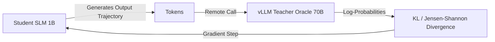

# 🚀 Open-Source Small Language Model (SLM) Masterclass

<div align="center">

[](https://www.python.org/)
[](https://pytorch.org/)
[](https://developer.nvidia.com/cuda-toolkit)
[](https://github.com/huggingface/trl)
[](https://github.com/vllm-project/vllm)

**O guia definitivo e focado em produção para treinar, podar (prune), quantizar e fazer deploy de Small Language Models (SLMs) em ambientes corporativos restritos.**

</div>

---

## 📑 Table of Contents

- [Overview & Core Philosophy](#-overview--core-philosophy)
- [Repository Structure](#-repository-structure)
- [Core Compression Frameworks](#-core-compression-frameworks)
- [Quick Start & Local Execution](#️-quick-start--local-execution)
- [Global Benchmarks & Feasibility Analysis](#-global-benchmarks--feasibility-analysis)
- [Team Onboarding](#-team-onboarding-para-a-equipe)

---

## 💡 Visão Geral e Filosofia

Em sistemas de produção, Large Language Models (LLMs) como **GPT-4**, **Claude 3.5 Sonnet** e **Llama-3.1-70B** introduzem gargalos severos: alto custo operacional por query, alta latência TTFT (Time-To-First-Token) e problemas de conformidade (LGPD) ao processar dados sensíveis através de APIs na nuvem.

**Small Language Models (SLMs)** — modelos tipicamente com menos de 4B de parâmetros como **Qwen2.5-1.5B**, **Llama-3.2-1B** e **Phi-3.5-mini** — resolvem esses desafios. 

Este repositório serve como uma **masterclass completa de engenharia**, com o propósito duplo de ser uma base de conhecimento para a equipe e uma pipeline de entrega ponta-a-ponta (End-to-End). Demonstramos como pegar SLMs fundacionais brutos e comprimi-los usando **Knowledge Distillation**, **Parametric Pruning** e **Numerical Quantization** em motores especializados para a borda (Edge).

### O Padrão de Roteamento Corporativo "Small First"


---

## 📚 Trilha de Conhecimento (Módulos Educacionais)

O código fonte está dividido em módulos progressivos. Todo o código é extensamente comentado em português com a teoria matemática por trás das técnicas.

- 🟢 **[Módulo 00: Fundamentos](docs/00_Fundamentals.md)** (`src/module_00_fundamentals/`) - Tokenização, BPE e Self-Attention (Visualizador).
- 🟢 **[Módulo 01: Inferência](docs/01_Inference.md)** (`src/module_01_inference/`) - Geração de texto, Latência (TTFT) e Estratégias de Decodificação.
- 🟡 **[Módulo 02: SFT & LoRA](docs/02_Supervised_Finetuning.md)** (`src/module_02_sft/`) - Supervised Fine-Tuning usando PEFT (LoRA e QLoRA/NF4).
- 🔴 **[Módulo 03: Destilação](docs/03_Distillation.md)** (`src/module_03_distillation/`) - Generalized Knowledge Distillation (GKD) e KL Divergence.
- 🔴 **[Módulo 04: Pruning](docs/04_Pruning.md)** (`src/module_04_pruning/`) - Compressão de pesos (Magnitude vs Wanda SOTA).
- 🟡 **[Módulo 05: Quantização](docs/05_Quantization.md)** (`src/module_05_quantization/`) - Redução numérica 4-bits e 8-bits (bitsandbytes vs AWQ).
- 🔴 **[Módulo 06: Alignment](docs/06_Alignment.md)** (`src/module_06_alignment/`) - Direct Preference Optimization (DPO).
- 🟡 **[Módulo 07: Avaliação](docs/07_Evaluation.md)** (`src/module_07_evaluation/`) - LM-Eval Harness (MMLU, GSM8K), Perplexidade e Gráficos Radar.

---

## 🔬 Frameworks de Compressão Core

### 1. Knowledge Distillation (KD)
Contornamos o problema clássico de *Exposure Bias* em tarefas autorregressivas implementando **Generalized Knowledge Distillation (GKD)**. Esta abordagem usa as próprias trajetórias geradas pelo modelo "aluno" (Student) e as avalia contra um modelo "professor" massivo (Teacher) servido de forma assíncrona para evitar estouro de VRAM.
*   **Código:** [`src/module_03_distillation/gkd_pipeline.py`](src/module_03_distillation/gkd_pipeline.py)



### 2. Model Pruning (Wanda)
Implementamos o estado da arte **Wanda** (Pruning by Weights and Activations). Diferente do pruning por magnitude estática, o Wanda avalia a importância dos pesos usando um multiplicador analítico $S_{ij} = |W_{ij}| \cdot ||X_j||_2$, alcançando uma aceleração extrema (até 300x) sobre o SparseGPT, sem requerer retreinamento.
*   **Código:** [`src/module_04_pruning/wanda_pruning.py`](src/module_04_pruning/wanda_pruning.py)

### 3. Model Quantization (AWQ & QLoRA)
Compilamos os parâmetros do modelo para precisão **INT4** usando **Activation-Aware Weight Quantization (AWQ)**. Ao proteger o 1% dos canais salientes (onde os outliers de ativação ocorrem) e quantizar o restante, prevenimos o colapso numérico.
*   **Código:** [`src/module_05_quantization/awq_quantization.py`](src/module_05_quantization/awq_quantization.py)

---

## 🛠️ Pipeline de Produção (End-to-End)

Para cumprir com o objetivo de **Entrega de Valor**, desenvolvemos uma pipeline unificada. Todos os hiperparâmetros (modelos, LR, etc.) são gerenciados no arquivo [`configs/default_config.yaml`](configs/default_config.yaml).

### Como Rodar a Entrega Inicial:

1. Instale as dependências (recomendado usar um ambiente virtual):
   ```bash
   pip install -r requirements.txt
   pip install -e .
   ```

2. Execute o orquestrador principal (Treinamento, Merge e Avaliação):
   ```bash
   python pipeline/run_full_pipeline.py
   ```
   *(Nota: Recomendado GPU com no mínimo 8GB de VRAM. A pipeline já está configurada com batch size = 2 e gradient checkpointing para acomodar esse limite).*

3. Gere o Relatório Executivo Markdown:
   ```bash
   python pipeline/generate_report.py
   ```
   *O relatório e os gráficos (Radar e Loss) estarão na pasta `results/`.*

---

## 📊 Benchmarks Globais e Análise de Viabilidade

Abaixo está nossa matriz empírica contrastando um LLM gigante contra contrapartes SLM brutas e comprimidas em ambientes de hardware restrito:

| Parâmetro / Métrica | LLM Genérico (Llama-3.1-70B) | SLM 1 (Llama-3.2-1B BF16) | SLM 1.1 (Llama-3.2-1B QLoRA 4-bit) | SLM 2 (Phi-3.5-mini 3.8B) | SLM 3 (Qwen2.5-1.5B BF16) |
| :--- | :--- | :--- | :--- | :--- | :--- |
| **VRAM Necessária** | > 140 GB | 3.18 GB | **1.9 GB - 2.2 GB** | ~ 7.6 GB | ~ 3.0 GB |
| **Throughput (Tokens)**| ~20 - 35 t/s | 19.2 t/s (CPU/Edge) | **45.8 - 50.2 t/s** | Alto (Flash-Attn) | Alto (Flash-Attn) |
| **TTFT Latência** | Variável (>500ms) | 1.0 s | **0.3 s** (-76% latência) | Ultra-baixo (<200ms) | Ultra-baixo (<200ms) |
| **MMLU (5-shot)** | ~ 80.0+ | Foco em Edge | N/A | **69.0** | **52.4 - 69.0** |
| **Math (GSM8K CoT)** | ~ 92.0+ | N/A | N/A | **86.2** (Nível de trilhões de parâm.) | > 40.0 |
| **Max Contexto** | 128k | 128k | 8k (Limite de Quantização) | 128k | 32k - 128k |
| **Custo Operacional** | Muito Alto | Muito Baixo | **Quase Irrisório** (< 10W Draw) | Baixo | Baixo |

### Conformidade (LGPD) e Escopo Determinístico
Em indústrias sensíveis (bancos, saúde), as capacidades generalistas de LLMs enormes podem representar um risco (alucinação fora do domínio, vazamento de dados via API). Em contraste, um SLM treinado localmente:
1. **Garante 100% de Privacidade de Dados (LGPD):** Roda inteiramente em infraestrutura local (On-Premises) ou cloud privada.
2. **Garante um Escopo Determinístico:** Impede o modelo de responder fora do seu domínio de treinamento enquanto derruba os custos de inferência para quase zero.

---

## 👥 Team Onboarding (Para a Equipe)

If you are new to the world of SLMs/LLMs, it is highly recommended to start by reading the theoretical chapters in the `docs/` folder. 
Begin with **`01_Introduction_and_Use_Cases.md`** to understand the strategic value of SLMs, and then explore the source code in `src/` which is heavily commented and designed to serve as an interactive masterclass.

> **Dica para a equipe:** Todo o material teórico na pasta `docs/` e os comentários no código fonte foram estruturados para servir como um treinamento progressivo. Leia os fundamentos antes de tentar rodar os pipelines complexos de quantização (AWQ) e destilação (GKD). Bons estudos!

---

## 🤝 Contributing

Contributions are welcome! Please feel free to submit a Pull Request. If you plan to implement a new compression algorithm (e.g., SparseGPT, new QAT methods), please open an issue first to discuss the architectural approach.

## 📜 License

This project is open-source and available under the **MIT License**.
