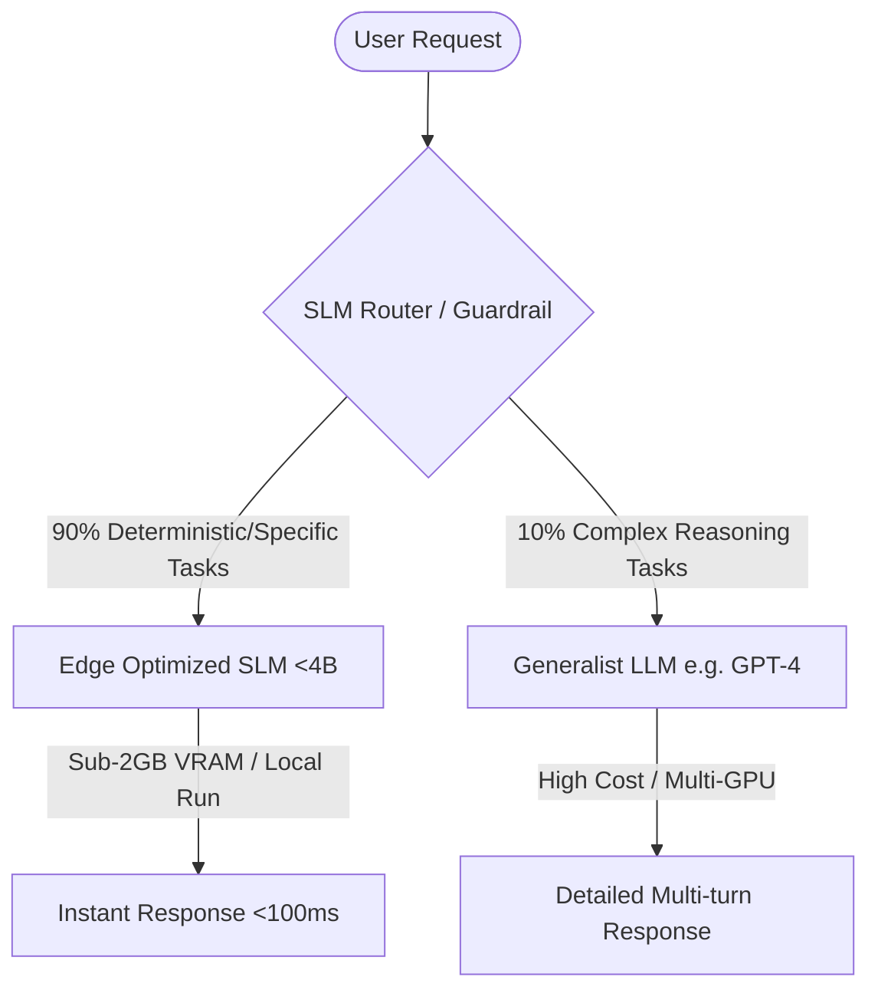
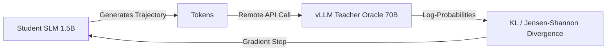

# 🚀 Open-Source Small Language Model (SLM) Masterclass

<div align="center">

[](https://www.python.org/)
[](https://pytorch.org/)
[](https://developer.nvidia.com/cuda-toolkit)
[](https://github.com/vinicius/Small-Language-Models-SLMs-/actions)
[](https://github.com/huggingface/trl)
[](https://github.com/vllm-project/vllm)

**The definitive production-grade guide to training, pruning, quantizing, and deploying Small Language Models (SLMs) in constrained enterprise environments.**

</div>

---

## 📑 Table of Contents

- [Overview \& Core Philosophy](#-overview--core-philosophy)
- [Educational Path \& Modules](#-educational-path--modules)
- [Core Compression Frameworks](#-core-compression-frameworks)
- [Production Pipeline (End-to-End)](#️-production-pipeline-end-to-end)
- [Global Benchmarks \& Feasibility Analysis](#-global-benchmarks--feasibility-analysis)
- [Team Onboarding](#-team-onboarding)
- [Testing & Quality Assurance](#-testing--quality-assurance)

---

## 💡 Overview & Core Philosophy

In production systems, massive Generalist Large Language Models (LLMs) like **GPT-4**, **Claude 3.5 Sonnet**, and **Llama-3.1-70B** introduce severe operational bottlenecks: high operational cost per query, high Time-To-First-Token (TTFT) latency, and strict data privacy compliance issues when processing sensitive information through external APIs.

**Small Language Models (SLMs)** — models typically under 4B parameters such as **Qwen2.5-1.5B**, **Llama-3.2-1B**, and **Phi-3.5-mini** — address these challenges.

This repository serves as a **production-grade engineering playbook**, doubling as an internal knowledge hub and an end-to-end delivery pipeline. It demonstrates how to take raw foundational SLMs and compress them using **Knowledge Distillation**, **Parametric Pruning**, and **Numerical Quantization** for local deployment at the edge.

### The "Small First" Corporate Routing Pattern



---

## 📚 Educational Path & Modules

The source code is structured into progressive modules. Every source file contains detailed educational explanations and logical justifications for the optimization decisions made:

- 🟢 **[Module 00: Fundamentals](docs/00_Fundamentals.md)** (`src/module_00_fundamentals/`) - Tokenization, BPE, and attention mechanism visualization.
- 🟢 **[Module 01: Inference](docs/01_Inference.md)** (`src/module_01_inference/`) - Text generation, Time-To-First-Token (TTFT) latency, and decoding strategies.
- 🟡 **[Module 02: SFT & LoRA](docs/02_Supervised_Finetuning.md)** (`src/module_02_sft/`) - Supervised Fine-Tuning using PEFT (LoRA and QLoRA/NF4) with built-in VRAM recovery safeguards.
- 🔴 **[Module 03: Distillation](docs/03_Distillation.md)** (`src/module_03_distillation/`) - Generalized Knowledge Distillation (GKD) using remote vLLM oracles with connection retries and exponential backoff.
- 🔴 **[Module 04: Pruning](docs/04_Pruning.md)** (`src/module_04_pruning/`) - Parameter compression using magnitude and state-of-the-art Wanda pruning.
- 🟡 **[Module 05: Quantization](docs/05_Quantization.md)** (`src/module_05_quantization/`) - 4-bit and 8-bit numerical quantization (bitsandbytes vs. AWQ).
- 🔴 **[Module 06: Alignment](docs/06_Alignment.md)** (`src/module_06_alignment/`) - Direct Preference Optimization (DPO).
- 🟡 **[Module 07: Evaluation](docs/07_Evaluation.md)** (`src/module_07_evaluation/`) - LM-Eval Harness benchmarks (MMLU, GSM8K), perplexity analysis, and radar charts.

---

## 🔬 Core Compression Frameworks

### 1. Knowledge Distillation (KD)
To address the *Exposure Bias* problem in autoregressive tasks, we implement **Generalized Knowledge Distillation (GKD)**. This approach uses the student model's own generation trajectories and compares them against a massive teacher model served asynchronously via vLLM to prevent local VRAM exhaustion.
* **Source:** [`src/module_03_distillation/gkd_pipeline.py`](src/module_03_distillation/gkd_pipeline.py)



### 2. Model Pruning (Wanda)
We implement the **Wanda** (Pruning by Weights and Activations) algorithm. Unlike static magnitude pruning, Wanda evaluates weight importance by combining parameter weights with activation magnitudes $S_{ij} = |W_{ij}| \cdot ||X_j||_2$, achieving significant compression speedups over SparseGPT without requiring full model retraining.
* **Source:** [`src/module_04_pruning/wanda_pruning.py`](src/module_04_pruning/wanda_pruning.py)

### 3. Model Quantization (AWQ & QLoRA)
We compress weights to **INT4** precision using **Activation-Aware Weight Quantization (AWQ)**. By protecting the top 1% of salient channels (where activation outliers occur) and quantizing the rest, we prevent numerical degradation while maintaining fast CUDA kernel speeds at the edge.
* **Source:** [`src/module_05_quantization/awq_quantization.py`](src/module_05_quantization/awq_quantization.py)

---

## 🛠️ Production Pipeline (End-to-End)

We provide a unified orchestration pipeline. All hyperparameters (learning rate, batch sizes, models) are managed centrally in [`configs/default_config.yaml`](configs/default_config.yaml).

### How to Run the Pipeline:

1. Install project dependencies and the package in editable mode:
   ```bash
   pip install -r requirements.txt
   pip install -e .
   ```

2. Run the end-to-end orchestration pipeline (Baseline Evaluation, SFT training, merging, and Fine-Tuned Evaluation):
   ```bash
   python pipeline/run_full_pipeline.py
   ```
   *(Note: A GPU with at least 8GB VRAM is recommended. The pipeline uses gradient checkpointing and memory safeguards to run under these limits).*

3. Compile the Technical Executive Report:
   ```bash
   python pipeline/generate_report.py
   ```
   *The Markdown report and generated visual figures will be written to the `results/` directory.*

---

## 📊 Global Benchmarks & Feasibility Analysis

Below is an empirical matrix comparing a massive generalist model against raw and compressed SLM counterparts running in constrained environments:

| Parameter / Metric | Generalist LLM (Llama-3.1-70B) | SLM 1 (Llama-3.2-1B BF16) | SLM 1.1 (Llama-3.2-1B QLoRA 4-bit) | SLM 2 (Phi-3.5-mini 3.8B) | SLM 3 (Qwen2.5-1.5B BF16) |
| :--- | :--- | :--- | :--- | :--- | :--- |
| **Required VRAM** | > 140 GB | 3.18 GB | **1.9 GB - 2.2 GB** | ~ 7.6 GB | ~ 3.0 GB |
| **Throughput**| ~20 - 35 t/s | 19.2 t/s (CPU Edge) | **45.8 - 50.2 t/s** | High (Flash-Attn) | High (Flash-Attn) |
| **TTFT Latency** | Variable (>500ms) | 1.0 s | **0.3 s** (-76% latency) | Ultra-low (<200ms) | Ultra-low (<200ms) |
| **MMLU (5-shot)** | ~ 80.0+ | Edge Focus | N/A | **69.0** | **52.4 - 69.0** |
| **Math (GSM8K CoT)** | ~ 92.0+ | N/A | N/A | **86.2** | > 40.0 |
| **Max Context** | 128k | 128k | 8k (Quantization limit) | 128k | 32k - 128k |
| **Operational Cost**| Very High | Very Low | **Irrisible** (< 10W Draw) | Low | Low |

### Privacy (LGPD/GDPR compliance) & Deterministic Scopes
In highly regulated industries (e.g., finance and healthcare), massive cloud APIs present security concerns. A local, optimized SLM offers:
1. **100% Data Privacy:** Runs entirely within private clouds or on-premises servers.
2. **Deterministic Behavior:** Keeps the model focused on domain-specific data, preventing out-of-domain hallucinations while reducing computing costs.

---

## 👥 Team Onboarding

If you are new to SLMs, we recommend starting with the theoretical modules in the `docs/` directory.

Begin with **`01_Introduction_and_Use_Cases.md`** to understand the business and operational utility of SLMs, then proceed to the commented modules in `src/` to learn the underlying mathematics.

---

## 🧪 Testing & Quality Assurance

This repository includes a unit testing suite to validate configurations, formatting utilities, metrics, and decoding configurations.

To execute tests:
```bash
pytest tests/
```
All unit tests operate on lightweight mock interfaces to ensure they can run quickly on CPU-only CI/CD environments.
