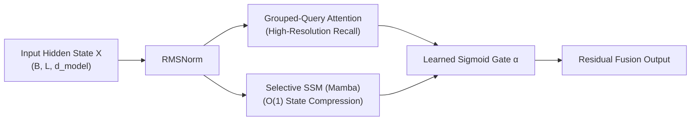

# Module 12: State-Space & Hybrid Mamba-Transformer SLMs

[](../README.md)
[](../src/module_12_hybrid_ssm/)

---

## 1. Executive & Architectural Motivation

While Grouped-Query Attention (GQA, Module 02) and Asymmetric `INT4` KV-Cache Quantization (Module 05B) significantly reduce the constant factor of autoregressive memory consumption, pure Transformer decoders remain bound by **$O(L)$ KV-cache memory growth** and **$O(L^2)$ prefill compute** with respect to sequence length $L$. At long context lengths ($L \ge 32\text{K}$ tokens) on memory-constrained edge NPUs, Laptops, and automotive SoCs, KV-cache allocation alone can exceed the static footprint of an `INT4` 1.5B SLM.

Frontier Small Language Model architectures—including **NVIDIA Hymba-1.5B** (`arXiv:2411.13676`), **IBM Granite-4.0** Hybrid Mamba-2, **AI21 Jamba-Mini** (`arXiv:2403.19887`), and **Zamba2** (`arXiv:2405.16712`)—solve this bottleneck by interleaving or fusing **Selective State-Space Models (Mamba / Mamba-2)** (`Gu & Dao, COLM 2024`, `Dao & Gu, ICML 2024`) with sparse GQA layers.

---

## 2. Mathematical Foundations

### 2.1 Continuous-to-Discrete Selective State-Space Model (S6)

A linear time-varying continuous state-space system maps a 1D input signal $u(t) \in \mathbb{R}$ to an output $y(t) \in \mathbb{R}$ via a latent state $h(t) \in \mathbb{R}^{N}$:

$$
\frac{dh(t)}{dt} = \mathbf{A} h(t) + \mathbf{B}(t) u(t), \qquad y(t) = \mathbf{C}(t) h(t) + \mathbf{D} u(t)
$$

In **Selective SSMs (S6)**, the step size $\Delta_t$, input projection $\mathbf{B}_t$, and output projection $\mathbf{C}_t$ are **functions of the input token $x_t$**:

$$
\Delta_t = \text{Softplus}(\mathbf{W}_\Delta x_t + b_\Delta), \quad \mathbf{B}_t = \mathbf{W}_B x_t, \quad \mathbf{C}_t = \mathbf{W}_C x_t
$$

Applying Zero-Order Hold (ZOH) discretization per channel $d \in \{1, \dots, D_{\text{inner}}\}$ yields the exact recurrent transition:

$$
\bar{\mathbf{A}}_t = \exp(\Delta_t \odot \mathbf{A}), \qquad \bar{\mathbf{B}}_t \approx \Delta_t \odot \mathbf{B}_t
$$

$$
h_t = \bar{\mathbf{A}}_t \odot h_{t-1} + \bar{\mathbf{B}}_t \odot u_t, \qquad y_t = (\mathbf{C}_t^\top h_t) + \mathbf{D} \odot u_t
$$

Because $h_t \in \mathbb{R}^{B \times D_{\text{inner}} \times N}$ has fixed dimensions independent of $t$, **autoregressive decoding requires $O(1)$ memory and $O(1)$ compute per step**.

### 2.2 Hybrid Mamba-Attention Parallel Fusion (Hymba / Jamba Architecture)

Pure SSMs compress the entire history into a fixed-size state $h_t$, which can degrade exact needle-in-a-haystack token copying over long spans. **Hymba** (`Dong et al., ICLR 2025`) and **Jamba** (`Lieber et al., 2024`) combine the high-resolution recall of GQA with the $O(1)$-state summarization of Mamba via parallel or interleaved blocks:



---

## 3. Reference Implementation

- **[`src/module_12_hybrid_ssm/hybrid_ssm_block.py`](../src/module_12_hybrid_ssm/hybrid_ssm_block.py)**:
  - `selective_ssm_scan`: Causal ZOH-discretized selective state-space scan returning both sequence outputs $y_{1:L}$ and final recurrent state $h_L$.
  - `SelectiveSSMBlock`: Full Mamba block with depthwise causal convolution (`nn.Conv1d`), SiLU gating, selective $\Delta, B, C$ projections, and an $O(1)$-memory `step_recurrent` method verified to match full-sequence causal scanning to within $< 10^{-5}$.
  - `HybridMambaAttentionBlock`: Parallel GQA + Selective SSM layer with per-channel learned sigmoid fusion gate $\alpha = \sigma(\mathbf{w}_{\text{gate}})$.
  - `profile_hybrid_memory_scaling`: Analytical profiler comparing pure Transformer GQA KV-cache vs. Hybrid Mamba-Transformer state memory across context lengths (achieving **6.88x memory reduction** at $L = 32,768$ with a 1:7 Attention-to-SSM ratio).

```bash
python src/module_12_hybrid_ssm/hybrid_ssm_block.py
```

---

## 4. Academic References

1. **Gu, A., & Dao, T.** (2024). *Mamba: Linear-Time Sequence Modeling with Selective State Spaces.* COLM 2024 (`arXiv:2312.00752`).
2. **Dao, T., & Gu, A.** (2024). *Transformers are SSMs: Generalized Models and Efficient Algorithms Through Structured State Space Duality (Mamba-2).* ICML 2024 (`arXiv:2405.21060`).
3. **Dong, X., et al.** (2024). *Hymba: A Hybrid-head Architecture for Small Language Models.* NVIDIA Research / ICLR 2025 (`arXiv:2411.13676`).
4. **Lieber, O., et al.** (2024). *Jamba: A Hybrid Transformer-Mamba Language Model.* AI21 Labs (`arXiv:2403.19887`).
